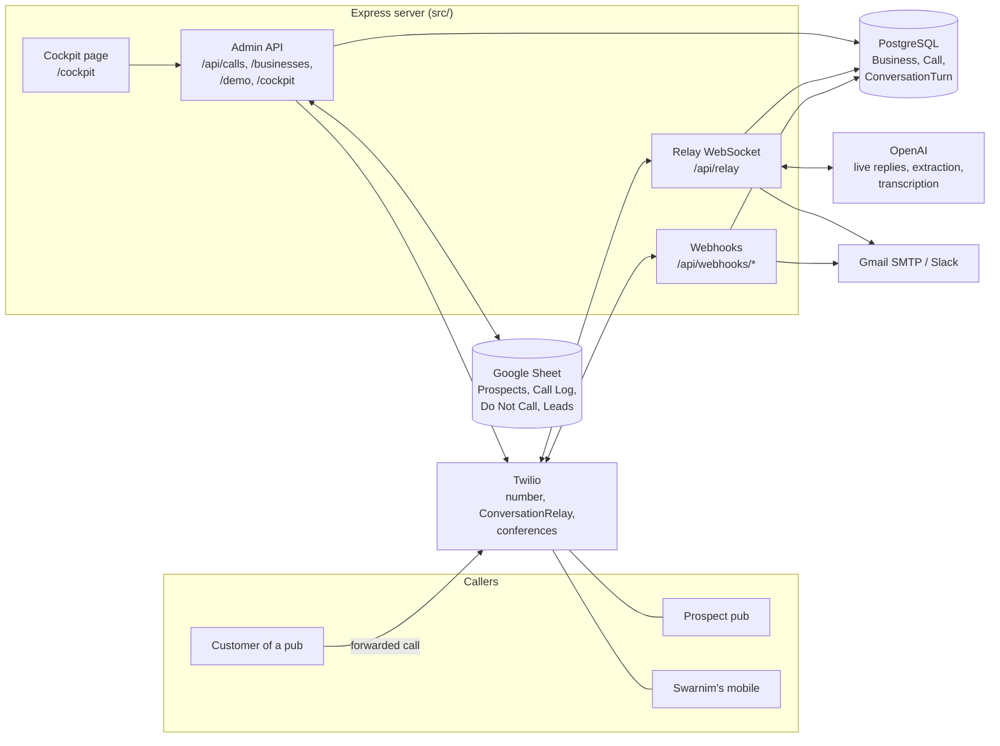
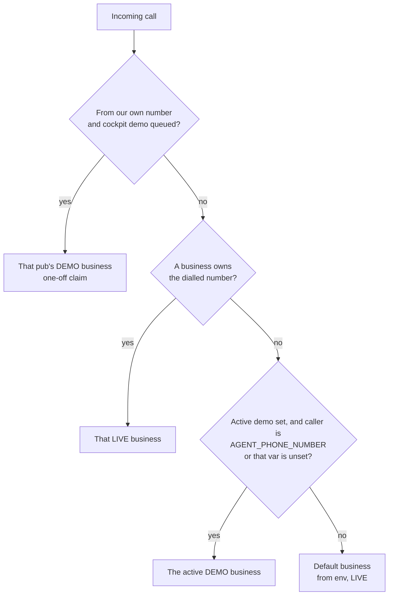
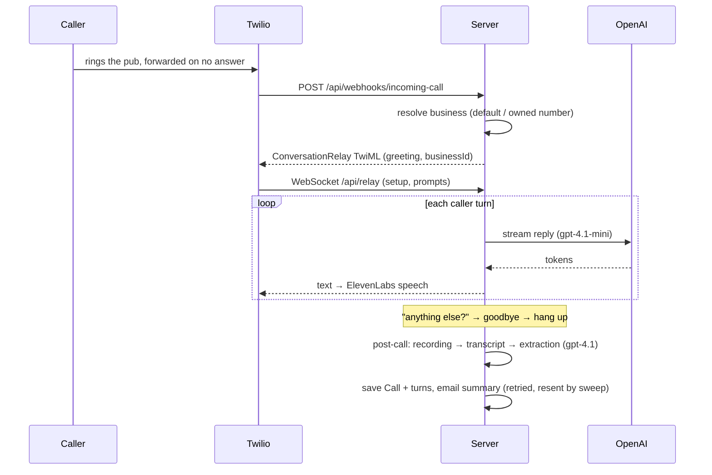

# Architecture

How the AI receptionist and the sales workflow fit together. For scope and order of work see
[`PLAN.md`](../PLAN.md); for the calling process see [`sales/PLAYBOOK.md`](sales/PLAYBOOK.md).

## The big picture

One Node.js/Express server does two jobs:

1. **The product (LIVE).** A pub's missed calls forward to our Twilio number. The AI answers as
   that business, takes a message or booking, and emails a summary. This path must never break.
2. **The sales tool (DEMO).** Swarnim calls a prospect pub from the calling cockpit and brings in
   a demo receptionist that answers *as that pub*. Results land in the Google Sheet.

Both use the same receptionist; what changes is the **Business** it answers for.



## Building blocks

| Piece | Where | What it does |
|---|---|---|
| Config | `src/config/index.ts` | Zod-validated env. Every setting lives here and in `.env.example`. |
| Business routing | `src/services/business.service.ts` | Decides which business a call is for; default business seeded from env. |
| Demo state | `src/services/demo.service.ts` | Active demo (30-min TTL) and the cockpit's one-off demo hand-off. In memory. |
| Prompts | `src/services/ai.service.ts` | LIVE prompt (take a message) and DEMO prompt (bookings, FAQs, answer as the pub); greetings; post-call extraction. |
| Live call loop | `src/services/relay.service.ts` | ConversationRelay WebSocket: streaming replies, barge-in, keypad, silence and time limits. |
| Webhooks | `src/api/routes/webhooks.ts` | Twilio callbacks (signature-validated): incoming call, Gather fallback, recording, status, cockpit legs. |
| Post-call pipeline | `src/services/call.service.ts` | Recording → transcript → extraction → DB → email/Slack/SMS → Call Log (demo calls). |
| Demo builder | `src/services/demo-builder.service.ts` | Research notes → DEMO business profile via LLM (facts only, no sales intel). |
| Sheets sync | `src/services/sheets.service.ts` | Reads/writes the sales sheet by header name; first-empty-row writes. |
| Cockpit | `src/services/cockpit.service.ts`, `src/api/routes/cockpit.ts`, `public/cockpit.html` | One sales call at a time: ring Swarnim → press 1 → conference → pub; demo participant; outcome. |
| Guards | `src/lib/calling-hours.ts`, `src/lib/phone.ts` | Calling window (UK time), UK number normalising, Do Not Call matching. |

## Which business answers a call

Every call fixes its business **when it starts** (`resolveBusinessForCall`), in this order:



- The chosen business id is passed to the relay session as a TwiML `<Parameter>`, so changing the
  demo mid-call never changes who a live call is for.
- Database trouble falls through to the default business (and to env values if even that can't
  be read): the call is always answered.
- Guard rails in the admin API: the default business can't be deleted or switched to DEMO, and a
  DEMO business can't own a Twilio number.

## Flow 1: a real missed call (LIVE)



## Flow 2: a sales call from the cockpit (DEMO)

```mermaid
sequenceDiagram
  participant You as Swarnim (cockpit + mobile)
  participant Server
  participant Twilio
  participant Pub
  participant Sheet
  You->>Server: Call "The Crown"
  Server->>Sheet: re-read Do Not Call + status; check calling hours
  Server->>Twilio: call AGENT_PHONE_NUMBER
  Twilio->>You: "Calling The Crown. Press 1 to dial them"
  You->>Twilio: 1
  Server->>Sheet: checks again
  Twilio->>Twilio: you join conference
  Twilio->>Server: conference-start
  Server->>Twilio: add participant: the pub (from our number)
  Twilio->>Pub: rings
  You->>Server: Bring in demo
  Server->>Twilio: mute you; add participant app:TWILIO_DEMO_APP_SID
  Twilio->>Server: incoming-call (from our number) → claims The Crown
  Note over Pub,Server: AI answers as The Crown; you unmute to take over
  You->>Server: Hang up, then outcome form
  Server->>Sheet: Call Log row, Prospects status/date, Do Not Call if asked
```

The AI never dials a prospect: the pub is only dialled after Swarnim presses 1 on his own phone
(PECR). If his voicemail answers, nothing is dialled.

## Data: where things live

| Store | Holds | Notes |
|---|---|---|
| PostgreSQL | `Business` (LIVE/DEMO profiles), `Call`, `ConversationTurn` | `Call.businessId` links each call to its business. Migrations in `prisma/migrations`. |
| Google Sheet | Prospects, Call Log, Do Not Call, Leads, Dashboard | Swarnim's working copy of the pipeline. App finds columns by header; never writes Dashboard or the Times called formula. |
| Server memory | Live call sessions, active demo, cockpit session, cockpit demo hand-off | Lost on restart; see limitations. |
| Twilio | Recordings | Linked from `Call.recordingUrl`. |

## Security

- Twilio webhooks are signature-validated (`validateTwilioSignature`), including the cockpit's.
- The relay WebSocket needs a token derived from the Twilio auth token.
- Admin API and cockpit API need `Authorization: Bearer ADMIN_API_KEY`; disabled without it.
  The `/cockpit` page itself holds no data; the key is typed in and kept in that browser tab.
- Secrets only via env (Twilio, OpenAI, SMTP, Google service account). Never committed or logged.

## Known limitations

- **Single server instance.** Live sessions, the active demo and the cockpit session are in
  memory. Run one instance; a restart mid-call drops the cockpit session (log the outcome by hand)
  and clears the active demo.
- **One cockpit call at a time** (one salesperson).
- **TwiML App participant not yet proven on a real call.** If the demo doesn't join, unset
  `TWILIO_DEMO_APP_SID`; the cockpit then brings it in by calling our own number.
- **Calling hours are UK time** regardless of `COMPANY_TIMEZONE`.

## Where to change things

| To change… | Edit |
|---|---|
| What the receptionist says | `ai.service.ts` (`buildLivePrompt`, `buildDemoPrompt`, `buildGreeting`) |
| Voice / speech recognition | env: `RELAY_VOICE`, `RELAY_SPEECH_MODEL`; `twilio.service.ts` |
| What goes in the summary email | `email.service.ts` |
| How a call picks its business | `business.service.ts` (`resolveBusinessForCall`) |
| Sheet columns or tabs | `sheets.service.ts` (`REQUIRED_HEADERS`) and the table in `CLAUDE.md` |
| Cockpit behaviour / page | `cockpit.service.ts`, `api/routes/cockpit.ts`, `public/cockpit.html` |
| Calling window | env `CALLING_HOURS` |

Before calling any change done: `npm run typecheck && npm run lint && npm test`.
